<a href="https://bvarun.com"><code>bvarun.com</code></a> &nbsp;·&nbsp; <a href="https://arch.bvarun.com"><code>arch.bvarun.com</code></a>

### `~/stack`

```text
.
├── core       Java 21 · Spring Boot · Spring Security · JWT · GraphQL
├── data       MongoDB · MySQL
├── infra      Docker · Jenkins · AWS · Linux
├── frontend   React · TypeScript · JavaScript · Vite · Tailwind
└── tools      Git · Postman · IntelliJ IDEA · VS Code
```

### `~/projects`

| project | what it does | the hard part |
|---|---|---|
| `zenlms` · private, in production | Learning and proctored-exam platform, ~2K students | JWT and role-based access, batch-scoped data for placement officers, server-owned deadlines with grace windows, idempotent proctoring events |
| [`codearch`](https://arch.bvarun.com) | Maps a repository: modules, endpoints, dependency cycles, hotspots | Static analysis across Java and TypeScript codebases of 1,000+ files |
| [`imaginealgos`](https://github.com/va-run-6626/ImagineAlgos) · [live](https://imagine-algos.vercel.app) | Interactive visualizers for sorting, searching and tree traversal | Animating algorithm state step by step in React |
| [`code365`](https://github.com/va-run-6626/Code365) | 365-day daily coding challenge | Consistency |

<br/>


