<p align="center">
  
</p>

<p align="center">
  
</p>

<p align="center">
  <a href="https://bvarun.com"></a>
  <a href="https://arch.bvarun.com"></a>
  
</p>

<br/>


```java
public class Varun {
    final String role     = "Backend Engineer";
    final String location = "Delhi, India";
    final String building = "CodeArch";
    final String motto    = "Veni, vidi, vici.";

    List<String> focus = List.of(
        "access control", "data scoping",
        "consistency", "deadlines", "failure handling");

    List<String> stack = List.of(
        "Java 21", "Spring Boot", "Spring Security",
        "JWT", "MongoDB", "MySQL");

    int studentsTaught = 100; // DSA & Java
}
```


<table align="center">
  <tr>
    <td align="right"><sub><b>FORGE</b></sub></td>
    <td>
      
      
      
      
      
    </td>
  </tr>
  <tr>
    <td align="right"><sub><b>VAULT</b></sub></td>
    <td>
      
      
    </td>
  </tr>
  <tr>
    <td align="right"><sub><b>FORT</b></sub></td>
    <td>
      
      
      
      
    </td>
  </tr>
  <tr>
    <td align="right"><sub><b>FACADE</b></sub></td>
    <td>
      
      
      
      
      
    </td>
  </tr>
  <tr>
    <td align="right"><sub><b>TOOLS</b></sub></td>
    <td>
      
      
      
      
    </td>
  </tr>
</table>


| Campaign | What it does | The battle |
|---|---|---|
| **ZenLMS** · production, private | Learning and proctored-exam platform, ~2K students | JWT and role-based access, batch-scoped data for placement officers, server-owned deadlines with grace windows, idempotent proctoring events |
| **[CodeArch](https://arch.bvarun.com)** | Maps a repository: modules, endpoints, dependency cycles, hotspots | Static analysis across Java and TypeScript codebases of 1,000+ files |
| **[ImagineAlgos](https://github.com/va-run-6626/ImagineAlgos)** · [live](https://imagine-algos.vercel.app) | Interactive visualizers for sorting, searching and tree traversal | Animating algorithm state step by step in React |
| **[Code365](https://github.com/va-run-6626/Code365)** | 365-day daily coding challenge | Consistency |


<p align="center">
  
</p>

<p align="center">
  
</p>

<picture>
  <source media="(prefers-color-scheme: dark)" srcset="https://raw.githubusercontent.com/va-run-6626/va-run-6626/output/legionary-dark.svg" />
  <source media="(prefers-color-scheme: light)" srcset="https://raw.githubusercontent.com/va-run-6626/va-run-6626/output/legionary.svg" />
  
</picture>


<p align="center">
  
</p>

<p align="center">
  
</p>
